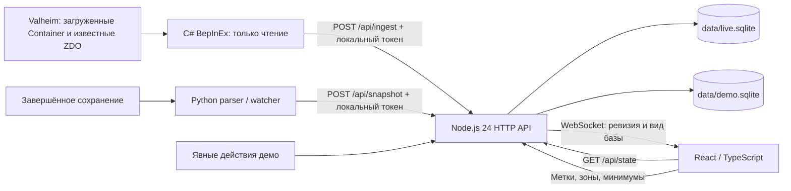

# Архитектура Valheim Resource Manager 0.3.0

## Полный каталог ChestSorter и история учёта — 18.10.2026

`GET /api/chestsorter` сохраняет обычные `resources`, `containers`, `stats`, минимумы и область учёта из `InventoryStore.state()`. Отдельное поле `chestSorter.catalog` объединяет эти ресурсы со всеми определениями текущего `ItemRegistry` и неизвестными prefab из истории мира. Дедупликация выполняется по точному каноническому prefab; hash разрешается только при однозначном соответствии. Спойлерные, служебные и ранее не наблюдавшиеся определения не отфильтровываются. `GET /api/state` и остальные вкладки не получают этот справочный список.

`InventoryStore.observedPrefabs(worldId)` читает существующую таблицу `observed_items`, не изменяя её. В неё ранее записывались положительные наблюдения источников и явные старые настройки при назначении общего минимума. Появление в истории либо в отслеживаемых ресурсах даёт `newToWorld:false`; остальные определения выбранного мира получают `true`. История общая для мира, переживает расход и уничтожение контейнеров, не сбрасывается фильтром зоны/500 м и индивидуальным минимумом 0. DEMO использует отдельную базу. При отсутствии выбранного мира красные пометки не назначаются. Это не персональный прогресс: инвентарь персонажа, рецепты и список известных материалов для определения пометки не читаются; события до начала учёта неизвестны.

Справочные строки имеют `catalogOnly:true`, `status:CATALOG`, пустые `containerIds`/`variants`, `availableQuantity:null`, `reservedQuantity:null`. Их технические `quantity:0` и `minimum:0` — заполнители совместимого формата `Resource`, не подтверждённые остатки. Интерфейс показывает «—», метку «НОВЫЙ»/«КАТАЛОГ», скрывает шкалу и редактор минимума в карточке. Такие строки исключены из сумм, числа сундуков и фильтра дефицита. Реальные строки сохраняют исходную свежесть и пороги; красный текст имени отмечает историю, цвет шкалы — уровень запаса.

Чтение вкладки не записывает открытия в историю, не назначает пороги и не меняет revision. Для группировки используется тот же независимый классификатор правил ChestSorter; добавление справочника не вызывает сортировку в игре. Существующие локальные чекбоксы категорий сохраняют свои ключи и значения.

`catalogSummary` отдельно сообщает число зарегистрированных определений, знаменатель исходного ObjectDB, число неразрешённых записей, новых/отслеживаемых строк и общий размер объединения. Чтением текущего локального runtime-манифеста проверены 1519 определений из 1522 ссылок (`runtimeVerified:true`, `complete:false`). Три пропущенных определения не создаются; отсутствие переводов/иконок не скрывает известный prefab. Внутренние ItemDrop NPC/эффектов остаются в полном каталоге. Этот результат не доказывает полноту всех объектов мира, личного прогресса или происхождение предметов каждого мода.

## Ручные отметки настройки сундуков — 18.10.2026

У категории ChestSorter есть отдельный checkbox «Сундук настроен», расположенный рядом с кнопкой сворачивания. Это независимые элементы управления: переключение отметки не раскрывает и не сворачивает группу. В localStorage сохраняется булево значение с ключом `vrm.chestsorter.chestReady.v1.` + JSON-массив `[worldId, categoryKey]`; categoryKey содержит нормализованный ID категории, поэтому переименование отображаемого названия не сбрасывает отметку. При смене мира React перемонтирует этот элемент с новым ключом и читает его собственное значение. Без выбранного мира checkbox недоступен. Зона и сворачивание не меняют сохранённую отметку.

В portable-приложении это приватное хранилище существующего Electron-профиля в `data/desktop-profile`; в обычном браузере — localStorage его origin. Отметки локальны для данного профиля, не отправляются backend или модификации, не импортируют и не изменяют игровые теги. Очистка профиля удаляет отметки вместе с другими настройками интерфейса. При недоступном localStorage применяется прежнее поведение предпочтений интерфейса: отметка работает в текущем компоненте без гарантии сохранения после закрытия.

## Представление категорий ChestSorter — 17.10.2026

`GET /api/chestsorter` возвращает ту же выборку `InventoryStore.state`, что `/api/state`, с отдельным полем `chestSorter` и назначением категории у каждого ресурса. Мир, DEMO, зона, якорь 500 м, количества, варианты, пороги, статусы и контейнеры остаются общими. Данные SQLite и назначения прежних кластеров не переписываются. Endpoint доступен только на существующем loopback API с прежними проверками Host/Origin; параметры запроса не задают файловые пути.

`server/chestsorter.mjs` независимо реализует документированный текстовый формат ChestSorter: комментарии/BOM, version 1–4, категории в порядке файла, aliases с максимумом восемь переходов, связи parent и приоритет `override → prefix → endswith → contains → suffix → foodcolor → itemtype`. Сопоставление строк не зависит от перевода предметов; `suffix` использует последнее PascalCase-слово с теми же правилами разбиения. Пищевой цвет считается по `food/foodHealth`, `foodStamina`, `foodEitr`: сначала доминирующий Eitr, затем Health/Stamina при строгом отношении менее половины, иначе Balanced. Для материалов fallback — Misc, для остальных — имя ItemType. Идентификатор категории канонизируется через объявление в файле.

Читается только `BepInEx/config/ChestSorter.categories.txt` из выбранной private game directory. Desktop передаёт функцию текущего выбранного пути; standalone backend читает собственный `data/desktop-game.json`. Тестовые desktop-порты не получают путь реальной игры. При чтении проверяются обычный файл/отсутствие ссылок в предках, размер до 256 КиБ, валидный UTF-8 и неизменность размера/mtime/inode во время чтения. Разобранные правила кешируются по SHA-256, а файл перечитывается на запрос. Некорректный/удалённый файл не использует прежние назначения молча: возвращаются invalid/unavailable и все предметы без категории. API не раскрывает полный путь или строки ошибочного конфига.

Неизвестный hash-prefab, отсутствующий тип или необходимые пищевые свойства остаются явно неразрешёнными; данные не угадываются по русскому имени или прежним категориям. Детерминированное wildcard-исключение может сработать без ItemType; потенциально более раннее scoped-правило при неизвестном типе останавливает назначение. UI показывает такие ресурсы отдельной группой. Категории из файла и дополнительные fallback-типы дают непересекающееся разбиение; фильтр родителя включает потомков с защитой от циклов. Пустые группы по умолчанию скрыты. Фильтры, сворачивание и количество колонок не меняют исходные остатки.

Это классификация списка, а не управление игровыми инвентарями. DLL ChestSorter не загружается, RPC/Push/Sort не вызываются; теги конкретных сундуков, `item:` назначения, группы и свободное место не импортируются. Фактический выбор сундука модом может зависеть от этих данных и позиции игрока. Правила и исходники стороннего мода не копируются в Git или EXE. Первичный источник формата: [описание автора ChestSorter](https://thunderstore.io/c/valheim/p/Heyaeyaeya/ChestSorter/).

## Один EXE с автоподключением — 17.10.2026

`desktop/build.mjs` теперь собирает собственную C# DLL с отключёнными отладочными символами и помещает только её и SHA-256 manifest в `desktop/bundled` внутри ASAR. Сторонние игровые/BepInEx/Harmony DLL туда не копируются. `desktop/integration.mjs` находит Steam через HKCU/стандартные папки, читает libraryfolders/appmanifest и устраняет повторы путей Windows без учёта регистра. При единственной установке ручной выбор не нужен; при нескольких или нестандартных расположениях используется native picker.

Перед добавлением DLL/CFG проверяются точный исследованный SHA-256 assembly_valheim, наличие существующего загрузчика/Harmony, обычные пути без junction и отсутствие неизвестных файлов по целевым адресам. Два контроля процесса отделяют подготовку от записи. При работающей игре первое подключение ждёт обычного закрытия. Известная совпадающая интеграция читается и используется во время игры без замены её файлов. Локальный токен создаётся автоматически; свежая папка EXE может принять уже настроенный токен известного собственного плагина. Если другая панель заняла порт, запрос с заведомо неполным ingest проверяет только совпадение локальной авторизации (ожидается 400); при несовпадении игра не перенастраивается.

Изменения ограничены собственной DLL/CFG. До записи сохраняются приватные before/after bytes и квитанция в `data/integration-backup`; повторные запуски идемпотентны. Замена токена сохраняет комментарии, SourceId и настройки сканирования. После отказа восстанавливаются только принадлежащие этой попытке файлы с ожидаемыми хешами; конкурентные изменения не перезаписываются. Сохранения мира и чужие моды не открываются для записи. Гарантий абсолютной изоляции от посторонних процессов того же пользователя нет.

Preload дополнен только выбором папки игры, действием запуска и булевым переключателем автозапуска игры. Launch использует фиксированный `steam://rungameid/892970`, без renderer URL/аргументов. Автоматический запуск выполняется один раз за сеанс приложения и отключается отдельной настройкой; Windows autorun/service не создаются. В изолированных QA-портах автоподключение игры выключено. Обычный старт требует только EXE, установленной игры и BepInEx; первоначальная загрузка DLL всё равно происходит при обычном запуске игры.

## Portable runtime — 17.10.2026

`desktop/main.mjs` работает в главном процессе Electron 44.9.0 (Node 24.22.0, проверен встроенный `node:sqlite`). `createApp` получает явные writable `dataDir`/`localDataDir` рядом с EXE и `distDir` внутри пакета. На свободном IPv4 loopback-порту 37841 сервер создаётся в этом же процессе. Только точный совместимый `/api/health` разрешает подключение к уже работающему серверу; чужой, зависший или несовместимый сервис не заменяется. Закрытие окна завершает только собственный runtime; занятый внешний backend не останавливается. Chromium имеет служебные дочерние процессы, которыми управляет приложение; CMD и отдельного сервера пользователю держать не нужно.

Одна копия окна защищена `requestSingleInstanceLock` по профилю. Native `BrowserWindow.setFullScreen` вызывается кнопкой/F11, Esc выключает полный экран. Renderer работает с `sandbox`, `contextIsolation`, выключенным Node integration и webSecurity. Узкий preload предоставляет статус, переключение полного экрана, native выбор каталогов, фиксированный запуск Valheim и булеву настройку запуска игры. Каждый IPC проверяет отправителя, основной frame и точный loopback origin; произвольные пути/команды из renderer не принимаются. Переходы на внешние origins, новые окна и browser permissions запрещены. Токен в preload/renderer не передаётся. Сохраняются прежние ограничения API/Origin/CSP; аутентификация локальных процессов отдельно не добавлена.

`desktop/runtime.mjs` ограниченно и скрыто вызывает штатный Windows `tasklist.exe`, сопоставляя только точное имя Valheim и PID. Этот признак не определяет мир. Главный процесс читает состояния известных миров и выбирает наиболее свежий подключённый неснимковый источник; UI следует ему только в автоматическом режиме. Ручной выбор остаётся фиксированным, после отключения источника показ последнего мира сохраняется.

`desktop/snapshot.mjs` переносит исследованный Python-декодер на Node Buffer/crypto без зависимости от Python. `snapshot-worker.mjs` читает snapshot вне UI-потока. Импортируются только завершённые поколения, с точным int64 UID, проверкой поддерживаемых форматов, counts, float32-идентичности, SHA-256 и неизменности всех исходных файлов. Discovery возвращает кандидатов, не выбирая их по mtime. Выбор сохраняется отдельно с точным UID; несовпадение блокирует импорт. Live-источник приостанавливает чтение. После ошибки действует минутная задержка повторения; перед POST проверяются пределы 3 МиБ/5000 контейнеров. Выбор каталога и фоновое чтение сериализованы. Snapshot сохраняет прежние ограничения частичного охвата и отсутствия удаления по отсутствию.

`desktop/build.mjs` создаёт отдельную staging-папку только из разрешённых runtime-файлов, `dist` и `ws`; electron-builder собирает один portable EXE без установщика. Приватные каталоги никогда не копируются. Временная распаковка Electron и соседние рабочие каталоги нужны даже при поставке одним EXE. Автозапуск Windows, Windows service, цифровая подпись и автоматическое обновление EXE не реализованы. Автоматическое добавление собственной DLL и запуск игры описаны выше. Будущие Electron-сборки требуют повторной проверки Node/SQLite и native acceptance.

## Временные панели и меню — 17.10.2026

`src/useOutsideDismiss.ts` содержит общий capture-обработчик `pointerdown` для карточки предмета, редактора зоны и помощи. Он проверяет `composedPath`/`contains` и закрывает только верхнюю зарегистрированную панель, не поглощая щелчок по основному интерфейсу. Явно помеченные `details[data-dismiss-on-outside]` закрываются отдельно при щелчке снаружи. Esc закрывает один вложенный список, затем панель; регистрация и очистка слушателей привязаны к жизненному циклу компонентов. Постоянные развороты кластеров/категорий и штатные `<select>` в этот механизм не входят.

## Общие минимумы и шкала запасов — 17.10.2026

`world_preferences.default_minimum` хранит общий минимум отдельно для каждого мира. `PUT /api/minimums/default` принимает `{worldId, minimum, resetOverrides?: boolean}`; `resetOverrides:true` атомарно сбрасывает индивидуальные пороги. API состояния сообщает `defaultMinimum`; `resource.minimum` выбирается как индивидуальное значение, включая 0, либо общий минимум. Сам новый мир начинает с 0, пока пользователь не задаст порог. В рабочем мире по запросу установлен минимум 200.

`observed_items` запоминает только фактически обнаруженные положительные стеки и прежние явно заданные минимумы. Установка общего порога заполняет этот список из существующих записей контейнеров; новые ingest-пакеты поддерживают его дальше. При полном расходе либо уничтожении сундука ресурс с положительным порогом остаётся нулевой строкой. Разрешение hash/prefab выполняется через реестр без повторных строк; весь ObjectDB не превращается в список дефицитов. Нулевой индивидуальный минимум отключает отсутствующую строку. Все пороги относятся к миру: вне выбранной области известный предмет может иметь нулевое количество. При `hostBedArea.status=unset` учёт по-прежнему приостановлен и нулевые строки тоже скрыты.

Общий `shared/stock-level.mjs` вычисляет уровень без зависимости от режима UI: ниже минимума — deficit, от минимума до 125% — near, от 125% — surplus. Некорректные количества и отключённый минимум дают нейтральную шкалу. `StockGauge` использует эту функцию во всех видах; маркер минимума находится на 80% диапазона. Переполнение полосы ограничено, но фактическое количество сохранено в доступном описании `meter`. Шкала не заменяет оценку свежести игрового источника.

## Обновление и восстановление установки — 17.10.2026

Установщик и обновлятор проверяют отдельную квитанцию с исходной записью об отсутствии собственных файлов. Обновление может заново добавить отсутствующую собственную DLL, сохраняя текущий CFG. Отличие CFG от квитанции принимается только как форматирование: все пары секция/ключ/значение должны совпасть с приватной резервной копией, чей SHA-256 равен ожидаемому хешу. Значения не выводятся. Новый хеш неизменённого текущего CFG фиксируется в новой квитанции и независимом `after.json`.

Замена файлов использует явную уникальную резервную копию на том же томе. После исключения восстановление проверяет фактическое наличие и хеши файлов, сохраняя данные для разбора неразрешённого сбоя. Это закрывает обнаруженный пробел прежнего обновлятора: поведение частичных ошибок `ReplaceFileW` [описано Microsoft](https://learn.microsoft.com/en-us/windows/win32/api/winbase/nf-winbase-replacefilew#return-value). Причина фактического исчезновения локальной папки плагина **UNKNOWN**; наличие такого пробела не доказывает, что он вызвал этот случай.

## Область учёта от кровати хоста — 17.10.2026

При создании нового ingest-пакета на основном потоке Unity плагин в роли `host` читает `Game.GetPlayerProfile()`, `PlayerProfile.HaveCustomSpawnPoint()` и `GetCustomSpawnPoint()`. Эти методы относятся к текущему UID мира. Никакие методы изменения точки, респавна, перемещения или проверки со сторонними эффектами не вызываются. Доступная точка даёт `hostBed: {status: 'set', x, y, z}`, отсутствие выбранной кровати — `{status: 'unset'}`; временно недоступный профиль не добавляет поле. Повтор HTTP использует прежний неизменяемый пакет. Имя и ID персонажа не передаются.

Backend принимает поле только от роли `host`, проверяет статус и конечные координаты. Последний принятый якорь хранится отдельно в SQLite с миром, источником, сессией и временем наблюдения. `state.hostBedArea` сообщает `pending / active / unset`, радиус 500 м и признак `applied`. До первого отчёта `pending` сохраняет прежний охват с явным предупреждением UI. После `set` все количества, кластеры и контейнеры ограничены условием `hypot(container.x - x, container.z - z) <= 500`. Высота Y не ограничивает область; граница входит в круг. Выбранная обычная зона применяется как дополнительное пересечение. `unset` приостанавливает учёт и возвращает пустую выборку. Отсутствующее поле старого плагина не очищает уже известную точку; уход хоста сохраняет последнюю привязку. Записи вне радиуса не удаляются.

Сохранённая привязка не доказывает наличие целой кровати в данный момент. Dedicated server и клиент чужого сервера не знают нужный локальный профиль. Поле роли является заявлением авторизованного локального сборщика, а не независимым доказательством сетевой роли. Реальное получение точки новой DLL и перенос привязки внутри игры остаются непроверенными до её загрузки. Ручной `UPDATE-GAME-PLUGIN.cmd` возвращает отсрочку при работающей игре; desktop-приложение повторяет первичное подключение после её обычного закрытия. Совместимая установленная DLL автоматически не обновляется.

Описание соответствует исходному коду MVP. Публичная поставка содержит собственные исходники и тестовые синтетические данные, без игровых библиотек, сохранений, персональных идентификаторов и рабочих SQLite. Runtime-проверка новой DLL из текущих исходников внутри игры ещё не выполнена; результаты и границы подтверждения приведены в [TEST_REPORT.md](TEST_REPORT.md).

## Дополнение: доставка и восстановление иконок — 17.10.2026

Реестр и PNG поступают отдельными запросами: наличие `iconKey` в манифесте не доказывает наличие файла. Backend отдаёт прямую иконку при наличии PNG, иначе ищет последнюю доступную иконку по паре **точный prefab + gameVersion**. Приватный `localdata/registry/icon-cache.json` переживает перезапуск; `localdata/installed-assets/registry/items.json` и `icons/` служат дополнительным источником настоящих локальных изображений. Кеш не подменяет runtime-определение, идентичность предмета, количества или заявленное покрытие. Иконки другой версии либо другого prefab не заимствуются.

Приём отдельного PNG помечает реестр для обновления без полного перечитывания и WebSocket-уведомления на каждый файл. Обычный трёхсекундный tick объединяет изменения; завершённый манифест по-прежнему сообщает обновление. Frontend допускает две повторные попытки для видимой иконки с задержками 2 и 10 секунд; смена URL начинает новый ограниченный цикл.

В новых исходниках C# экспорт использует отдельный HTTP-клиент с таймаутом 10 секунд и не публикует манифест, пока не доставлены все PNG. Ошибка содержит этап и безопасный код HTTP/исключения без тела ответа и токена. Эта DLL собрана, но не заменяет плагин уже работающей игры. Точная первая ошибка прежней доставки **UNKNOWN**: таймаут остаётся гипотезой, поскольку прежний обработчик её не сохранял. Все извлечённые PNG, runtime-каталог и кеш исключены из публикации.

PASS 3 добавляет независимую логическую таксономию в `server/clusters.mjs`. Реестр обогащает определение полями `clusterId`, `clusterCategoryId`, названиями, источником решения и тегами. Старые категории, ID, hash и исходные стэки не переписываются. `localdata/registry/clusters.json` и `overrides.json` переживают замену `items.json`; каждый prefab имеет один основной путь, включая неоднозначный fallback. Ручные назначения доступны для неизвестных ID. Кластеры глобальны для определений, а суммы вычисляются по конкретному миру и выбранной физической зоне.

Backend и `src/clusters.ts` считают количества из агрегированных ресурсов, сундуки — по объединению ID. `statusContainerIds` позволяет показать MIXED без повторного учёта одного сундука. NORMAL и COMPACT используют ту же выборку; поиск временно раскрывает родительские группы. Версионированные localStorage-настройки сохраняют группировку, сворачивание, прокрутку и фильтры. Memo COMPACT-строк сравнивает только отображаемые данные. Правила, API и ограничения классификации описаны в [RESOURCE_CLUSTERS.md](RESOURCE_CLUSTERS.md).

## 1. Потоки данных

В PASS 2 добавлен отдельный поток определений: установленный ObjectDB → Python `ValheimIconExporter` → `localdata/registry/items.json` + `localdata/icons/`, либо работающий ObjectDB → C# `RegistryExporter` → авторизованные `/api/registry` и `/api/icons/<sha256>.png`. Снимки количества по-прежнему хранятся отдельно в `data/live.sqlite`. Переиндексация определений не проигрывает inventory-пакеты заново и не увеличивает остатки.

`server/registry.mjs` проверяет ID, точный signed stable hash, метаданные, знаменатель покрытия и источники. Строковый ID `prefab:<точное имя>` является основным; `hash:<число>` разрешается только при единственном совпадении. Неоднозначные и неизвестные значения сохраняются с исходным ID/количеством. Ресурсы объединяются по prefab, а варианты `quality`/`variant` остаются в стэках и отдельной сводке. Название и изображение никогда не являются ключом. Существующая SQLite сохраняет исходные значения, обогащение производится при чтении.

PNG разрешены только по 64-символьному SHA-256, до 512 КиБ и 2048×2048; проверяются заголовок и соответствие хешу. API ограничен loopback, Host/Origin и токеном для экспорта. Каталог с ошибкой не заменяет последний исправный; `registry.loadError` виден в диагностике. Локальные категории из `localdata/registry/overrides.json` переживают переиндексацию. Эвристики категорий не гарантируют семантической точности: неразобранные записи явно отмечены.

Полнота разделена на `installed-assets` и `runtime-objectdb`. `runtimeVerified` не выводится из статических файлов, успешной компиляции или совпадения числа предметов. Три записи установленного ObjectDB без разрешённого ItemDrop остаются в знаменателе: текущая проверка даёт 1519/1522, а не 100%. Точные результаты — в [ITEM_REGISTRY.md](ITEM_REGISTRY.md).

React сохраняет NORMAL/COMPACT, плотность, группировку, свёрнутые категории, столбцы и фокус в localStorage с проверкой типов. Ключи строк и правой панели основаны на ID. Контейнер таблицы остаётся смонтирован при переключении, запоминает вертикальную/горизонтальную прокрутку и восстанавливает её при появлении результатов. WebSocket инициирует чтение состояния с отменой устаревших запросов. Виртуализация не добавлена: на проверенных 271 ресурсах достаточно обычной таблицы; производительность очень больших пользовательских списков не измерена.



Сервер отдаёт production assets из `dist/` на том же origin, что API и `/ws`. Отдельного облачного сервиса нет. Vite используется при разработке и сборке; штатный запуск не требует Vite-процесса. Все штатные адреса backend привязаны к `127.0.0.1:37841`; Vite dev-панель по умолчанию использует `127.0.0.1:5173`.

`scripts/vite-proxy.mjs` согласует dev-origin с backend для HTTP `/api` и WebSocket `/ws`. Замена Origin на адрес настроенного backend выполняется только когда входной Host имеет вид `127.0.0.1:<port>` или `localhost:<port>` с портом 1–65535, а входной Origin точно равен `http://<Host>`. Несовпадающий, посторонний или недопустимый Origin сохраняется: backend продолжает отклонять его с `403`. Политика доступа самого backend не изменена. Интеграционный тест запускает настоящие Vite и backend на временных портах с отдельной тестовой SQLite и проверяет оба транспорта, несовпадающие Origin/Host и недопустимые порты.

## 2. Live-сборщик C#

### Версия и область чтения

`plugin/Plugin.cs` — BepInEx-плагин `local.valheimresourcemanager`. Компиляция использует локальные Unity Mono, Valheim, BepInEx, Harmony и Newtonsoft.Json references; `Private=false` исключает копирование игровых DLL в результат.

Сборщик разрешает экспорт только для Valheim `1.0.20`, проверяет исследованное поле ревизии `Container.m_lastRevision`. Host-скан зависит от отражения `ZDOMan.m_objectsBySector`; при недоступности ожидаемого поля этот способ сканирования пропускается. Номер версии и успешная компиляция не удостоверяют совместимость с произвольным набором модов.

Сборщик исключает контейнеры транспорта, телег, кораблей, `ZSyncTransform`, надгробий и другие движущиеся объекты. Каталог подходящих стационарных prefab строится из доступных игровых prefab. Инвентарь игрока не перечисляется. Источник сообщает режим `client`, `host` или `server` в зависимости от сетевой роли, но всегда отправляет `coverage: partial`.

### Наблюдение и расписание

| Механизм | Реализация |
|---|---|
| Первичное обнаружение | Harmony postfix `Container.Awake` и поиск загруженных `Container` каждые 10 секунд |
| Изменение содержимого | Подписка на `Inventory.m_onChanged`; dirty-набор считывается раз в 350 мс |
| Периодическая сверка | Содержимое загруженных отслеживаемых контейнеров перечитывается каждые 3 секунды |
| Heartbeat | При отсутствии изменений пустой ingest примерно каждые 3 секунды |
| Host/server scan | Примерно каждые 20 секунд начинается проход известных секторов ZDO |
| Бюджет прохода ZDO | До 4 000 посещённых записей и до 1 мс в одном `Update`; остановка по первому достигнутому пределу |
| Доставка | До 300 наблюдений и 1 000 подтверждений уничтожения в одном пакете |
| Повтор после ошибки | Неизменённый сериализованный пакет, задержка около 3 секунд |

350 мс — период обработки dirty-набора, а не измеренная общая задержка. Бюджет 1 мс относится к проходу persisted ZDO, а не ко всей работе `Update`, discovery или сериализации. Одновременные изменения сундуков не образуют атомарный игровой снимок: перенос между двумя сундуками может временно отобразиться после подтверждения только одной стороны.

Перед чтением загруженного контейнера проверяется согласованность его vanilla inventory/ZDO revision. Неинициализированный inventory не трактуется как пустой. Host/server дополнительно читает существующий сериализованный inventory blob подходящих **незагруженных** ZDO, не меняя ownership и не запуская принудительную загрузку игровых областей.

Выгрузка `Container` удаляет локальную подписку, но не отправляет уничтожение. `destroyedIds` формируется из настоящего callback `m_onZDODestroyed` только для наблюдавшихся объектов. Это сохраняет остатки сундуков при уходе игрока с базы.

### Сеансы и отказоустойчивость

При входе в мир создаётся новый `sessionId`; `sourceId` относится к установке и хранится в локальном CFG, UID мира передаётся строкой. Последовательность пакетов растёт внутри мира/источника/сеанса. Unity-объекты читаются на основном потоке; в `Task.Run` отправляется уже сериализованный неизменный JSON. HTTP proxy и redirects отключены; разрешён только loopback HTTP.

При временной недоступности backend сохраняется in-flight body, новые наблюдения накапливаются/заменяются в pending по runtime ID. Очередь существует в памяти игры, поэтому закрытие процесса может потерять недоставленные наблюдения; последующая сверка должна подтвердить актуальное содержимое. Постоянно отклоняемый пакет автоматически не разделяется и не пропускается, что может остановить доставку до устранения причины. Прямой вызов игровых API сохранения, изменения inventory или захвата ownership не предусмотрен.

## 3. Snapshot parser и watcher

`scripts/read_snapshot.py` читает последнее завершённое поколение `_main.N.ok` и связанные mapping, `.fwl2` и chunk файлы. Parser проверяет границы строк/пакетов, версии, обязательные поля, counts в каждом чанке и общий count из mapping, числовые диапазоны, уникальность mapping и точных ключей сундуков. Неподдерживаемые версии, усечённые данные и неоднозначные идентичности отклоняются.

Поддерживаемый исследованный диапазон: chunk 40–42, inventory 108–110. Snapshot-каталог контейнеров ограничен четырьмя распознанными prefab: деревянный, укреплённый, из чёрного металла и личный сундук. Объекты с inventory blob вне whitelist учитываются в диагностическом счётчике, но не выдаются за сундуки. Неизвестный item hash сохраняет количество и ключ `hash:<значение>`; имя предмета не угадывается.

Входные файлы целиком читаются в память, хешируются SHA256 и повторно проверяются перед импортом. Менявшееся во время чтения поколение отклоняется. Это согласованность прочитанных файлов; игровой осмотр контейнеров и полнота prefab-каталога таким способом не доказываются. Большие миры требуют времени и памяти, процесс не имеет гарантированного секундного SLA.

Время наблюдения snapshot берётся из mtime completion marker, не из момента импорта. Перенос файла или изменение его mtime могут исказить это время. Метаданные игрока при разборе отбрасываются. World name, UID, координаты и содержимое сундуков остаются в приватных payload/manifest и локальной базе.

CLI по умолчанию копирует входные файлы в новый output-каталог для аудита. Watcher вызывает parser с `retain_bytes=False`, сохраняя payload и manifest без копий чанков. Оба варианта записывают только результаты проекта, не игровые файлы.

`scripts/watch_snapshot.py` использует приватный `data/snapshot-source.json`, раз в 5 секунд ищет новое завершённое поколение и не начинает тяжёлый разбор, пока API сообщает активный источник этого мира. После успешного импорта обновляет `data/snapshot-checkpoint.json`. При ошибке пишет диагностическое сообщение и пробует снова. Текущая конфигурация/checkpoint рассчитаны на один выбранный мир; автоматического поиска сохранений, проверки нового реального поколения и переключения множества миров пока нет. Snapshot всегда `partial`, не генерирует `destroyedIds` и не подтверждает работу игрового плагина.

## 4. Идентичность контейнеров

В исследованном chunk-42 формате Valheim 1.0.20 runtime ZDOID не сохраняется и меняется после загрузки. Использовать порядок ZDO в сохранении как настоящий ID нельзя.

Стационарный ключ:

```text
identityKey = pos-v1:<signed prefabHash>:<x float32 bits hex8>:<y bits>:<z bits>
API container.id = stable:<identityKey>
SQLite primary key = (world_id, id)
```

World UID отделён на уровне базы; одинаковые локальные keys разных миров не объединяются. Координаты кодируются точными битами float32, без округления. Runtime `zdoId` хранится отдельно строкой, без преобразования в JavaScript number. Для snapshot UI не показывает выдуманный runtime ID. Внутренний `snapshot:` идентификатор помечает происхождение, API-состояние snapshot возвращает `zdoId: null`.

Это позволяет объединить snapshot и последующее live-наблюдение неподвижного сундука и сохранить его метку при смене runtime ZDOID. Уничтожение сопоставляется только с ID соответствующего источника/текущего сеанса; ID старого сеанса не должен удалять другой объект.

Ограничения: перемещение меняет ключ; два контейнера одного prefab с точно одинаковыми XYZ неоднозначны; замена сундука таким же prefab на точно том же месте может выглядеть как прежний объект. Дубликаты и конфликтующие координаты отклоняются с откатом пакета. Legacy путь без `identityKey` оставлен для API fixtures; интеграция всегда должна передавать стабильный ключ.

## 5. HTTP и транзакции SQLite

`server/main.mjs` создаёт две независимые `InventoryStore`: `data/live.sqlite` и `data/demo.sqlite`. Используются `node:sqlite`, WAL, foreign keys и `synchronous=FULL`. Основные таблицы: миры, источники, сеансы, контейнеры, зоны, минимумы, события и метаданные/ревизия. Контейнер хранит последнее нормализованное содержимое; это не сумма истории доставок.

Ingest валидируется до записи; изменение выполняется транзакцией `BEGIN IMMEDIATE`. Пакет содержит world/source/session, sequence, режим, coverage, gameVersion, наблюдения и явные destruction IDs. Внутри одного контейнера одинаковые prefab складываются; новое наблюдение заменяет прежнее содержимое целиком. Пропущенный контейнер сохраняется. Явное подтверждение уничтожения исключает его из остатков.

Для последнего принятого пакета сеанса сохраняется SHA256 от `JSON.stringify` валидированного payload. Точный повтор с тем же sequence и digest возвращает прежнюю ревизию, не обновляя свежесть. Иное тело с тем же sequence, старый sequence или уже завершённый сеанс дают `409`. Это требует неизменённого тела повтора, а не произвольной семантически эквивалентной перестановки JSON-полей.

Будущий `observedAt` ограничивается временем получения. Более старое наблюдение не затирает новое. Snapshot не заменяет свежее активное live-наблюдение, включая равные timestamps; последующий live merge использует стабильную идентичность без второго сундука. Записи миров и пользовательские метки разделены UID мира.

## 6. Актуальность и агрегирование

`lastSeenAt` — receipt heartbeat источника. `lastConfirmedAt` — последнее настоящее наблюдение retained контейнера выбранного мира. UI использует второе поле для времени обновления inventory.

- Источник отключён после **12 секунд** без контакта.
- `LIVE`: активный источник, текущий сеанс и наблюдение не старше **15 секунд**.
- `STALE`: источник активен, но наблюдение устарело или относится к старому сеансу.
- `OFFLINE`: источник недоступен; содержимое остаётся последним известным.
- `SNAPSHOT`: реальное чтение сохранения, независимо от heartbeat.

Ресурс агрегируется по текущим содержимым выбранных контейнеров. Его статус — наименее актуальный из contributing контейнеров. При нескольких источниках summary предпочитает активный host/server, затем client, затем последний источник, а свежесть каждого контейнера определяется его собственным источником.

Зона — круг в X/Z; Y не влияет на включение. `all` считает все известные контейнеры, включая вне зон; выбор зоны фильтрует выдачу, не удаляя записи. Первый реальный импорт создаёт `Основная база` радиусом 100 м с `proposed:true`; сохранение пользователем центра/радиуса убирает этот флаг. Это предложение не подтверждает границы базы.

Дефицит возникает, когда заданный minimum больше остатка. Ресурс с minimum и нулевым известным количеством остаётся в выдаче. Реальные минимумы не выдумываются. Неизвестные prefab сохраняют входное название и попадают в `Прочее`; известные названия и категории задаёт локальный каталог.

## 7. WebSocket и интерфейс

`/ws` отправляет `{type: 'state-changed', revision, demo}` без inventory и токенов. Клиент после уведомления читает `GET /api/state` для выбранных demo/world/zone. Backend также уведомляет о временных переходах статусов примерно каждые 3 секунды; UI дополнительно сверяет состояние каждые 5 секунд и восстанавливает WebSocket через 3 секунды после разрыва.

`src/App.tsx` отменяет старый fetch через `AbortController`, проверяет generation и scope demo/world/zone. Это исключает применение запоздавшего ответа к другому выбранному миру или режиму. В интерфейсе есть каталог, фильтры, карточки/таблица, детализация мест хранения, редактирование локальных меток, minimums и зон. Предметные пиктограммы читаются из локального экспорта игры; собственные SVG используются только для элементов интерфейса и favicon. Отсутствующая игровая иконка даёт нейтральное сокращение названия.

Метки, зоны и минимумы изменяют только соответствующую SQLite. Демо запускается явно и меняет только `demo.sqlite`; `ingest` всегда направлен в реальную базу. Синтетические действия не являются игровыми событиями.

## 8. API и границы доступа

Полные схемы находятся в [shared/contract.md](shared/contract.md).

| Метод/путь | Назначение |
|---|---|
| `GET /api/health` | Состояние приложения без секретов |
| `GET /api/state?demo=0\|1&worldId=...&zoneId=all\|...` | Состояние выбранной базы, мира и зоны |
| `POST /api/ingest` | Live-наблюдения, `X-VRM-Token` |
| `POST /api/snapshot` | Snapshot payload, `mode=snapshot`, `coverage=partial`, токен |
| `POST /api/containers/<encoded id>/label` | Локальная метка |
| `PUT /api/minimums` | Минимальный запас |
| `POST /api/zones`, `PUT /api/zones/<id>` | Создание/изменение зоны |
| `POST /api/demo/start`, `POST /api/demo/step` | Явные синтетические сценарии |
| `/ws` | Уведомления о необходимости перечитать state |

Сервер слушает IPv4 loopback, проверяет точный Host/порт и при наличии Origin разрешает только собственный localhost/127.0.0.1 origin. CORS для сторонних сайтов не включён. JSON mutations требуют `Content-Type: application/json`; тело ограничено **3 МиБ**, до 5 000 контейнеров/destruction IDs и до 2 048 item-строк на контейнер. Строки и количества валидируются. CSP и path containment ограничивают раздачу assets из `dist`.

Токен генерируется локально, хранится в `data/ingest-token.txt`, передаётся игровому CFG и сравнивается без timing-dependent обычного string equality. У меток/зон/minimums нет отдельного пользовательского логина: HTTP-клиенты того же компьютера могут обращаться к ним, а Origin защищает от посторонних web origins, не от локальных процессов. Windows ACL и права процесса проект не настраивает; файловый `mode` Node не является гарантией Unix-подобной изоляции на Windows. TLS, удалённый доступ и multi-user модель отсутствуют.

## 9. Установка и приватные артефакты

Установщик сверяет точный исследованный SHA256 игровой DLL, требует существующий BepInEx и не перезаписывает загрузчик/другие моды. Для собственной DLL/CFG сначала фиксирует отсутствие, затем пишет новые файлы, проверяет хеши и сохраняет manifest + независимую before/after квитанцию. Повторная одинаковая установка ничего не меняет. Отдельный updater проверяет сохранность собственной DLL/CFG и отсутствие игры, делает резервную копию и заменяет только DLL с обновлением квитанции; CFG и остальные файлы сравниваются по SHA-256.

Откат проверяет root, paths, reparse points, квитанцию и хеши. Удаляются только неизменённые собственные файлы; изменённые и чужие остаются. Скрипты запуска/остановки проверяют собственные процессы, не прерывая Valheim.

В `.gitignore` исключаются рабочие `data/`, `localdata/`, `.runtime/`, `output/`, игровые сохранения, заполненные конфиги, секреты, журналы, зависимости, build outputs и локальные материалы исследования игры. В репозитории не должны появляться Valheim/Unity DLL, декомпиляции игры или игровые ассеты. Публичные тесты используют fixtures; настоящий snapshot и доказательства локального аудита остаются приватными.

## 10. Оставшиеся ограничения

- Live runtime, +40 дерева в настоящем сундуке, реальная задержка, уничтожение/перенос/выгрузка в игре и совместимость модов не подтверждены.
- Более новое завершённое сохранение автоматически обработано watcher; ручной игровой сценарий и задержка этого цикла не измерялись.
- Охват частичный: доступные области клиента, известные ZDO host/server, snapshot whitelist и неизвестные prefab.
- Версия/хеш привязаны к исследованной сборке; обновления требуют аудита.
- Ключ по точной позиции ограничен стационарными объектами и не разрешает все возможные замены/совпадения.
- Обновление нескольких сундуков не является одной игровой транзакцией; очередь отправки не постоянная, постоянный отказ пакета блокирует последующие.
- Snapshot хранит последние известные данные без вывода уничтожений по отсутствию; это может сохранять старые записи до live-подтверждения.
- Нет гарантии нагрузки/задержки на больших мирах, полноценной сетевой авторизации и крафтовых рецептов. Runtime-экспорт модовых определений из ObjectDB реализован, но не проверен в игре; предметы модов вне ObjectDB требуют отдельного адаптера.
