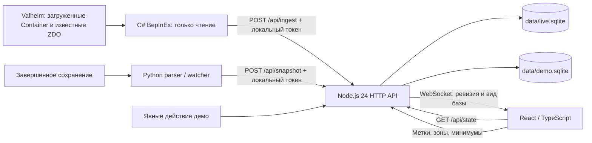

# Архитектура Valheim Resource Manager 0.1.0

Описание соответствует исходному коду MVP. Публичная поставка содержит собственные исходники и тестовые синтетические данные, без игровых библиотек, сохранений, персональных идентификаторов и рабочих SQLite. Runtime-проверка плагина внутри игры ещё не выполнена; результаты и границы подтверждения приведены в [TEST_REPORT.md](TEST_REPORT.md).

## 1. Потоки данных



Сервер отдаёт production assets из `dist/` на том же origin, что API и `/ws`. Отдельного облачного сервиса нет. Vite используется при разработке и сборке; штатный запуск не требует Vite-процесса. Все штатные адреса привязаны к `127.0.0.1:37841`. Известная ошибка dev proxy: браузерный POST с Vite-origin `127.0.0.1:5173` сохраняет этот Origin и отклоняется проверкой backend с `403 ORIGIN_REJECTED`. Production-origin на `37841` работает в проверенных сценариях; WebSocket через dev-origin отдельно не проверен.

## 2. Live-сборщик C#

### Версия и область чтения

`plugin/Plugin.cs` — BepInEx-плагин `local.valheimresourcemanager`. Компиляция использует локальные Unity Mono, Valheim, BepInEx, Harmony и Newtonsoft.Json references; `Private=false` исключает копирование игровых DLL в результат.

Сборщик разрешает экспорт только для Valheim `1.0.20`, проверяет исследованное поле ревизии `Container.m_lastRevision`. Host-скан зависит от отражения `ZDOMan.m_objectsBySector`; при недоступности ожидаемого поля этот способ сканирования пропускается. Номер версии и успешная компиляция не удостоверяют совместимость с произвольным набором модов.

Сборщик исключает контейнеры транспорта, телег, кораблей, `ZSyncTransform`, надгробий и другие движущиеся объекты. Каталог подходящих стационарных prefab строится из доступных игровых prefab. Инвентарь игрока не перечисляется. Источник сообщает режим `client`, `host` или `server` в зависимости от сетевой роли, но всегда отправляет `coverage: partial`.

### Наблюдение и расписание

| Механизм | Реализация |
|---|---|
| Первичное обнаружение | Harmony postfix `Container.Awake` и поиск загруженных `Container` каждые 10 секунд |
| Изменение содержимого | Подписка на `Inventory.m_onChanged`; dirty-набор считывается раз в 350 мс |
| Периодическая сверка | Содержимое загруженных отслеживаемых контейнеров перечитывается каждые 3 секунды |
| Heartbeat | При отсутствии изменений пустой ingest примерно каждые 3 секунды |
| Host/server scan | Примерно каждые 20 секунд начинается проход известных секторов ZDO |
| Бюджет прохода ZDO | До 4 000 посещённых записей и до 1 мс в одном `Update`; остановка по первому достигнутому пределу |
| Доставка | До 300 наблюдений и 1 000 подтверждений уничтожения в одном пакете |
| Повтор после ошибки | Неизменённый сериализованный пакет, задержка около 3 секунд |

350 мс — период обработки dirty-набора, а не измеренная общая задержка. Бюджет 1 мс относится к проходу persisted ZDO, а не ко всей работе `Update`, discovery или сериализации. Одновременные изменения сундуков не образуют атомарный игровой снимок: перенос между двумя сундуками может временно отобразиться после подтверждения только одной стороны.

Перед чтением загруженного контейнера проверяется согласованность его vanilla inventory/ZDO revision. Неинициализированный inventory не трактуется как пустой. Host/server дополнительно читает существующий сериализованный inventory blob подходящих **незагруженных** ZDO, не меняя ownership и не запуская принудительную загрузку игровых областей.

Выгрузка `Container` удаляет локальную подписку, но не отправляет уничтожение. `destroyedIds` формируется из настоящего callback `m_onZDODestroyed` только для наблюдавшихся объектов. Это сохраняет остатки сундуков при уходе игрока с базы.

### Сеансы и отказоустойчивость

При входе в мир создаётся новый `sessionId`; `sourceId` относится к установке и хранится в локальном CFG, UID мира передаётся строкой. Последовательность пакетов растёт внутри мира/источника/сеанса. Unity-объекты читаются на основном потоке; в `Task.Run` отправляется уже сериализованный неизменный JSON. HTTP proxy и redirects отключены; разрешён только loopback HTTP.

При временной недоступности backend сохраняется in-flight body, новые наблюдения накапливаются/заменяются в pending по runtime ID. Очередь существует в памяти игры, поэтому закрытие процесса может потерять недоставленные наблюдения; последующая сверка должна подтвердить актуальное содержимое. Постоянно отклоняемый пакет автоматически не разделяется и не пропускается, что может остановить доставку до устранения причины. Прямой вызов игровых API сохранения, изменения inventory или захвата ownership не предусмотрен.

## 3. Snapshot parser и watcher

`scripts/read_snapshot.py` читает последнее завершённое поколение `_main.N.ok` и связанные mapping, `.fwl2` и chunk файлы. Parser проверяет границы строк/пакетов, версии, обязательные поля, counts в каждом чанке и общий count из mapping, числовые диапазоны, уникальность mapping и точных ключей сундуков. Неподдерживаемые версии, усечённые данные и неоднозначные идентичности отклоняются.

Поддерживаемый исследованный диапазон: chunk 40–42, inventory 108–110. Snapshot-каталог контейнеров ограничен четырьмя распознанными prefab: деревянный, укреплённый, из чёрного металла и личный сундук. Объекты с inventory blob вне whitelist учитываются в диагностическом счётчике, но не выдаются за сундуки. Неизвестный item hash сохраняет количество и ключ `hash:<значение>`; имя предмета не угадывается.

Входные файлы целиком читаются в память, хешируются SHA256 и повторно проверяются перед импортом. Менявшееся во время чтения поколение отклоняется. Это согласованность прочитанных файлов; игровой осмотр контейнеров и полнота prefab-каталога таким способом не доказываются. Большие миры требуют времени и памяти, процесс не имеет гарантированного секундного SLA.

Время наблюдения snapshot берётся из mtime completion marker, не из момента импорта. Перенос файла или изменение его mtime могут исказить это время. Метаданные игрока при разборе отбрасываются. World name, UID, координаты и содержимое сундуков остаются в приватных payload/manifest и локальной базе.

CLI по умолчанию копирует входные файлы в новый output-каталог для аудита. Watcher вызывает parser с `retain_bytes=False`, сохраняя payload и manifest без копий чанков. Оба варианта записывают только результаты проекта, не игровые файлы.

`scripts/watch_snapshot.py` использует приватный `data/snapshot-source.json`, раз в 5 секунд ищет новое завершённое поколение и не начинает тяжёлый разбор, пока API сообщает активный источник этого мира. После успешного импорта обновляет `data/snapshot-checkpoint.json`. При ошибке пишет диагностическое сообщение и пробует снова. Текущая конфигурация/checkpoint рассчитаны на один выбранный мир; автоматического поиска сохранений, проверки нового реального поколения и переключения множества миров пока нет. Snapshot всегда `partial`, не генерирует `destroyedIds` и не подтверждает работу игрового плагина.

## 4. Идентичность контейнеров

В исследованном chunk-42 формате Valheim 1.0.20 runtime ZDOID не сохраняется и меняется после загрузки. Использовать порядок ZDO в сохранении как настоящий ID нельзя.

Стационарный ключ:

```text
identityKey = pos-v1:<signed prefabHash>:<x float32 bits hex8>:<y bits>:<z bits>
API container.id = stable:<identityKey>
SQLite primary key = (world_id, id)
```

World UID отделён на уровне базы; одинаковые локальные keys разных миров не объединяются. Координаты кодируются точными битами float32, без округления. Runtime `zdoId` хранится отдельно строкой, без преобразования в JavaScript number. Для snapshot UI не показывает выдуманный runtime ID. Внутренний `snapshot:` идентификатор помечает происхождение, API-состояние snapshot возвращает `zdoId: null`.

Это позволяет объединить snapshot и последующее live-наблюдение неподвижного сундука и сохранить его метку при смене runtime ZDOID. Уничтожение сопоставляется только с ID соответствующего источника/текущего сеанса; ID старого сеанса не должен удалять другой объект.

Ограничения: перемещение меняет ключ; два контейнера одного prefab с точно одинаковыми XYZ неоднозначны; замена сундука таким же prefab на точно том же месте может выглядеть как прежний объект. Дубликаты и конфликтующие координаты отклоняются с откатом пакета. Legacy путь без `identityKey` оставлен для API fixtures; интеграция всегда должна передавать стабильный ключ.

## 5. HTTP и транзакции SQLite

`server/main.mjs` создаёт две независимые `InventoryStore`: `data/live.sqlite` и `data/demo.sqlite`. Используются `node:sqlite`, WAL, foreign keys и `synchronous=FULL`. Основные таблицы: миры, источники, сеансы, контейнеры, зоны, минимумы, события и метаданные/ревизия. Контейнер хранит последнее нормализованное содержимое; это не сумма истории доставок.

Ingest валидируется до записи; изменение выполняется транзакцией `BEGIN IMMEDIATE`. Пакет содержит world/source/session, sequence, режим, coverage, gameVersion, наблюдения и явные destruction IDs. Внутри одного контейнера одинаковые prefab складываются; новое наблюдение заменяет прежнее содержимое целиком. Пропущенный контейнер сохраняется. Явное подтверждение уничтожения исключает его из остатков.

Для последнего принятого пакета сеанса сохраняется SHA256 от `JSON.stringify` валидированного payload. Точный повтор с тем же sequence и digest возвращает прежнюю ревизию, не обновляя свежесть. Иное тело с тем же sequence, старый sequence или уже завершённый сеанс дают `409`. Это требует неизменённого тела повтора, а не произвольной семантически эквивалентной перестановки JSON-полей.

Будущий `observedAt` ограничивается временем получения. Более старое наблюдение не затирает новое. Snapshot не заменяет свежее активное live-наблюдение, включая равные timestamps; последующий live merge использует стабильную идентичность без второго сундука. Записи миров и пользовательские метки разделены UID мира.

## 6. Актуальность и агрегирование

`lastSeenAt` — receipt heartbeat источника. `lastConfirmedAt` — последнее настоящее наблюдение retained контейнера выбранного мира. UI использует второе поле для времени обновления inventory.

- Источник отключён после **12 секунд** без контакта.
- `LIVE`: активный источник, текущий сеанс и наблюдение не старше **15 секунд**.
- `STALE`: источник активен, но наблюдение устарело или относится к старому сеансу.
- `OFFLINE`: источник недоступен; содержимое остаётся последним известным.
- `SNAPSHOT`: реальное чтение сохранения, независимо от heartbeat.

Ресурс агрегируется по текущим содержимым выбранных контейнеров. Его статус — наименее актуальный из contributing контейнеров. При нескольких источниках summary предпочитает активный host/server, затем client, затем последний источник, а свежесть каждого контейнера определяется его собственным источником.

Зона — круг в X/Z; Y не влияет на включение. `all` считает все известные контейнеры, включая вне зон; выбор зоны фильтрует выдачу, не удаляя записи. Первый реальный импорт создаёт `Основная база` радиусом 100 м с `proposed:true`; сохранение пользователем центра/радиуса убирает этот флаг. Это предложение не подтверждает границы базы.

Дефицит возникает, когда заданный minimum больше остатка. Ресурс с minimum и нулевым известным количеством остаётся в выдаче. Реальные минимумы не выдумываются. Неизвестные prefab сохраняют входное название и попадают в `Прочее`; известные названия и категории задаёт локальный каталог.

## 7. WebSocket и интерфейс

`/ws` отправляет `{type: 'state-changed', revision, demo}` без inventory и токенов. Клиент после уведомления читает `GET /api/state` для выбранных demo/world/zone. Backend также уведомляет о временных переходах статусов примерно каждые 3 секунды; UI дополнительно сверяет состояние каждые 5 секунд и восстанавливает WebSocket через 3 секунды после разрыва.

`src/App.tsx` отменяет старый fetch через `AbortController`, проверяет generation и scope demo/world/zone. Это исключает применение запоздавшего ответа к другому выбранному миру или режиму. В интерфейсе есть каталог, фильтры, карточки/таблица, детализация мест хранения, редактирование локальных меток, minimums и зон. Собственные SVG-иконки не извлекаются из игровых ассетов.

Метки, зоны и минимумы изменяют только соответствующую SQLite. Демо запускается явно и меняет только `demo.sqlite`; `ingest` всегда направлен в реальную базу. Синтетические действия не являются игровыми событиями.

## 8. API и границы доступа

Полные схемы находятся в [shared/contract.md](shared/contract.md).

| Метод/путь | Назначение |
|---|---|
| `GET /api/health` | Состояние приложения без секретов |
| `GET /api/state?demo=0\|1&worldId=...&zoneId=all\|...` | Состояние выбранной базы, мира и зоны |
| `POST /api/ingest` | Live-наблюдения, `X-VRM-Token` |
| `POST /api/snapshot` | Snapshot payload, `mode=snapshot`, `coverage=partial`, токен |
| `POST /api/containers/<encoded id>/label` | Локальная метка |
| `PUT /api/minimums` | Минимальный запас |
| `POST /api/zones`, `PUT /api/zones/<id>` | Создание/изменение зоны |
| `POST /api/demo/start`, `POST /api/demo/step` | Явные синтетические сценарии |
| `/ws` | Уведомления о необходимости перечитать state |

Сервер слушает IPv4 loopback, проверяет точный Host/порт и при наличии Origin разрешает только собственный localhost/127.0.0.1 origin. CORS для сторонних сайтов не включён. JSON mutations требуют `Content-Type: application/json`; тело ограничено **3 МиБ**, до 5 000 контейнеров/destruction IDs и до 2 048 item-строк на контейнер. Строки и количества валидируются. CSP и path containment ограничивают раздачу assets из `dist`.

Токен генерируется локально, хранится в `data/ingest-token.txt`, передаётся игровому CFG и сравнивается без timing-dependent обычного string equality. У меток/зон/minimums нет отдельного пользовательского логина: HTTP-клиенты того же компьютера могут обращаться к ним, а Origin защищает от посторонних web origins, не от локальных процессов. Windows ACL и права процесса проект не настраивает; файловый `mode` Node не является гарантией Unix-подобной изоляции на Windows. TLS, удалённый доступ и multi-user модель отсутствуют.

## 9. Установка и приватные артефакты

Установщик сверяет точный исследованный SHA256 игровой DLL, требует существующий BepInEx и не перезаписывает загрузчик/другие моды. Для собственной DLL/CFG сначала фиксирует отсутствие, затем пишет новые файлы, проверяет хеши и сохраняет manifest + независимую before/after квитанцию. Повторная одинаковая установка ничего не меняет; другая сборка требует проверенного отката.

Откат проверяет root, paths, reparse points, квитанцию и хеши. Удаляются только неизменённые собственные файлы; изменённые и чужие остаются. Скрипты запуска/остановки проверяют собственные процессы, не прерывая Valheim.

В `.gitignore` исключаются рабочие `data/`, `.runtime/`, `output/`, игровые сохранения, заполненные конфиги, секреты, журналы, зависимости, build outputs и локальные материалы исследования игры. В репозитории не должны появляться Valheim/Unity DLL, декомпиляции игры или игровые ассеты. Публичные тесты используют fixtures; настоящий snapshot и доказательства локального аудита остаются приватными.

## 10. Оставшиеся ограничения

- Live runtime, +40 дерева в настоящем сундуке, реальная задержка, уничтожение/перенос/выгрузка в игре и совместимость модов не подтверждены.
- Новый реальный цикл сохранение → watcher → API ещё не наблюдался после запуска watcher.
- Охват частичный: доступные области клиента, известные ZDO host/server, snapshot whitelist и неизвестные prefab.
- Версия/хеш привязаны к исследованной сборке; обновления требуют аудита.
- Ключ по точной позиции ограничен стационарными объектами и не разрешает все возможные замены/совпадения.
- Обновление нескольких сундуков не является одной игровой транзакцией; очередь отправки не постоянная, постоянный отказ пакета блокирует последующие.
- Snapshot хранит последние известные данные без вывода уничтожений по отсутствию; это может сохранять старые записи до live-подтверждения.
- Нет гарантии нагрузки/задержки на больших мирах, полноценной сетевой авторизации, крафтовых рецептов и автоматического разрешения неизвестных модовых предметов.
- Vite dev proxy не согласован с разрешённым Origin backend: POST с `5173` получает `403`; полный функционал доступен через production-сборку на `37841`.
